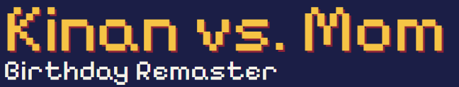

**A free platformer I made for my little brother Kinan's 11th birthday.** Eight worlds across Canada, 88 levels and
16 bosses you calm down and make friends with. It plays in the browser on phones, tablets and computers, with nothing
to download and no account.

### [▶ Play it free](https://albertancoder.github.io/kinan-vs-mom/)

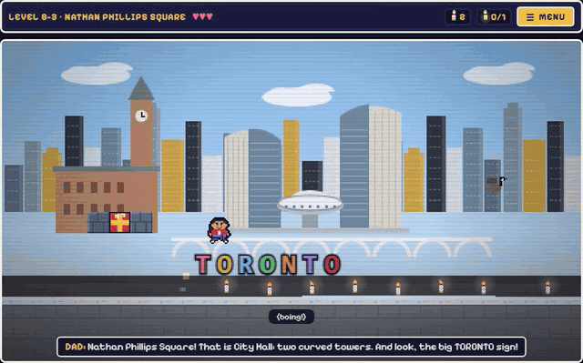

## The story

Kinan wakes up to a present from his big brother with a gift card that says *"Don't open this until I get there!"*
He takes one little peek. Out bursts **Glitchy**, a purple troublemaker with one eye, who zips past Mom
(*"Kinan, NO!"*) and out the window. Kinan chases Glitchy across Canada, one world at a time. At the end of every
world Glitchy escapes into the next one.

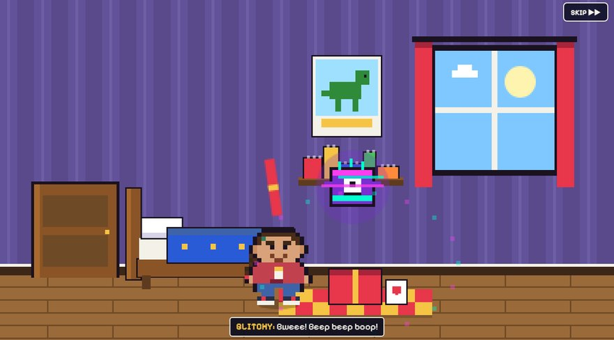

Kinan walks a map from stop to stop. Every world has 8 levels, a fort, a secret level and a castle, and everything
unlocks by playing.

## Eight worlds

| | |
|---|---|
| 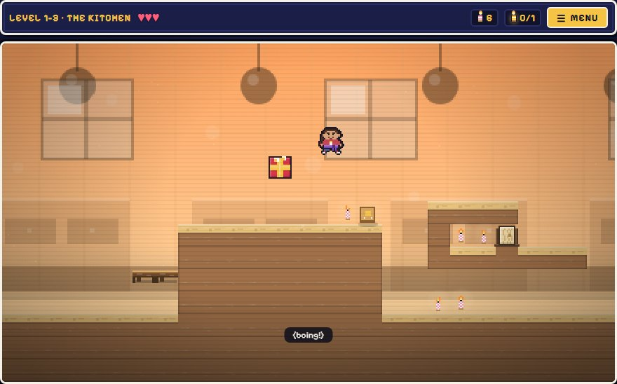 | 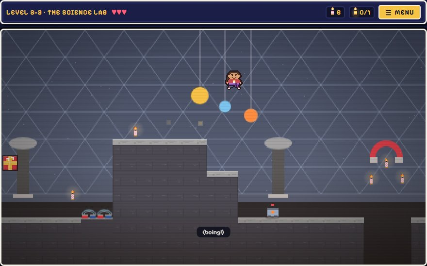 |
| **World 1: Saskatoon** | **World 2: School** |
| 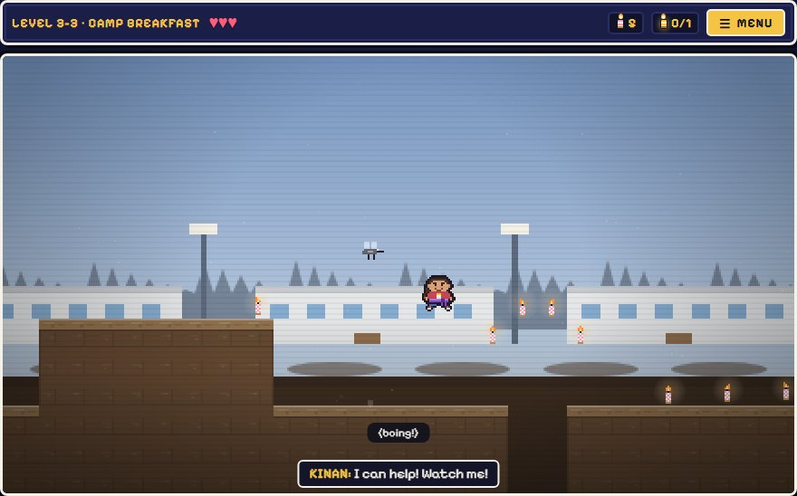 | 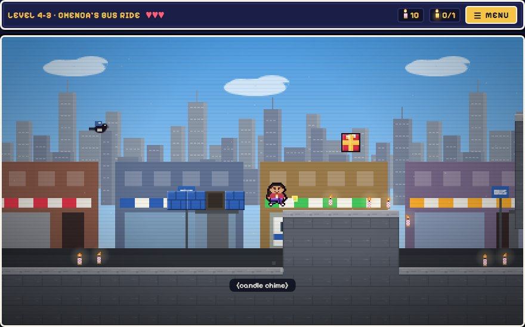 |
| **World 3: Dad's Oilfield** | **World 4: Edmonton** |
| 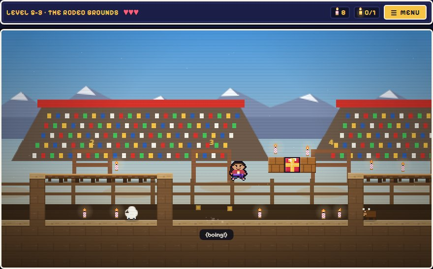 | 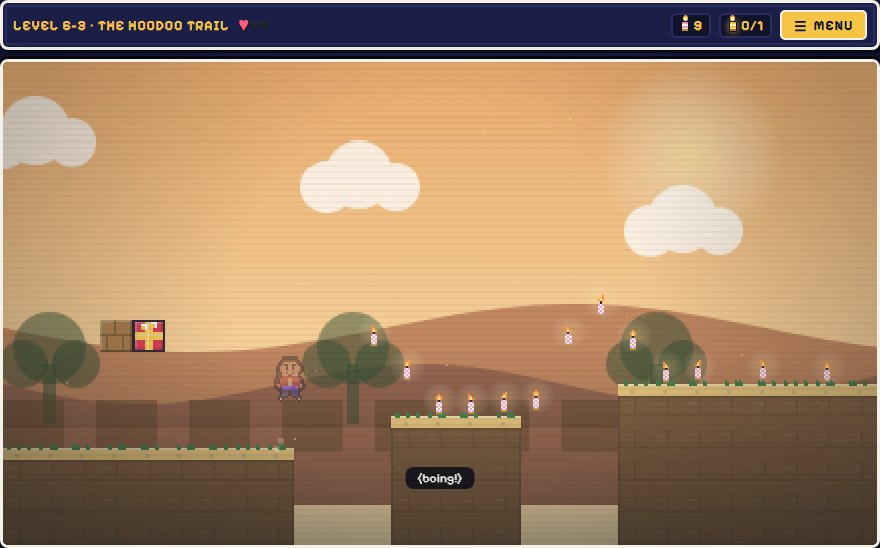 |
| **World 5: the Calgary Stampede** | **World 6: Drumheller** |
| 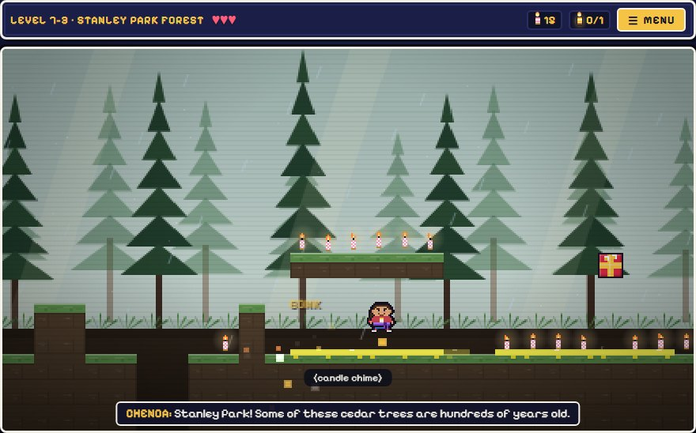 | 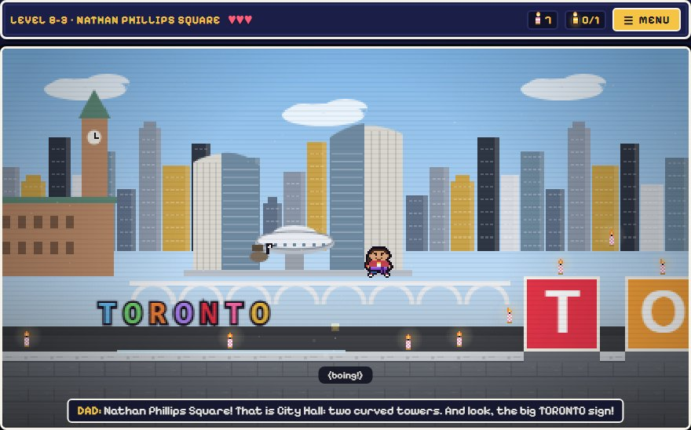 |
| **World 7: Vancouver** | **World 8: Toronto** |

More worlds are coming.

## Bosses you make friends with

Each world has a fort mini-boss and a castle boss: 16 in all, including Robo-Rex, the Giant Banana Slug, Drizzle the
Thunderstorm, the Big Octopus and the Raccoon King. Nobody gets beaten up. Each boss gets a little smarter after every
hit, then calms down and becomes a friend. Every attack is shown before it lands, and there's no game over: lose your
last heart and you start again from the last checkpoint. Get stuck in one spot five times and Glitchy offers to help.

| | |
|---|---|
| 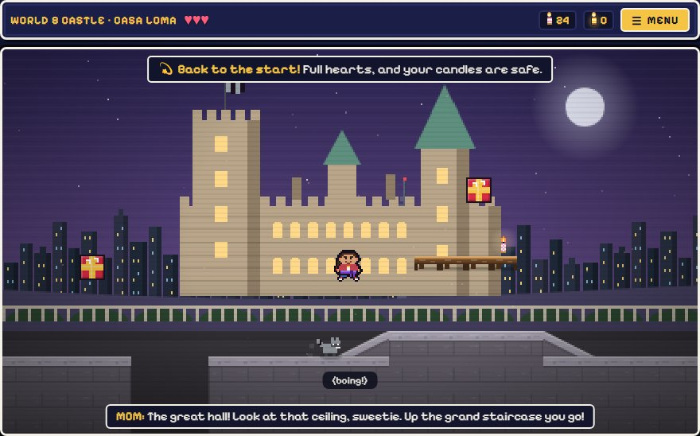 | 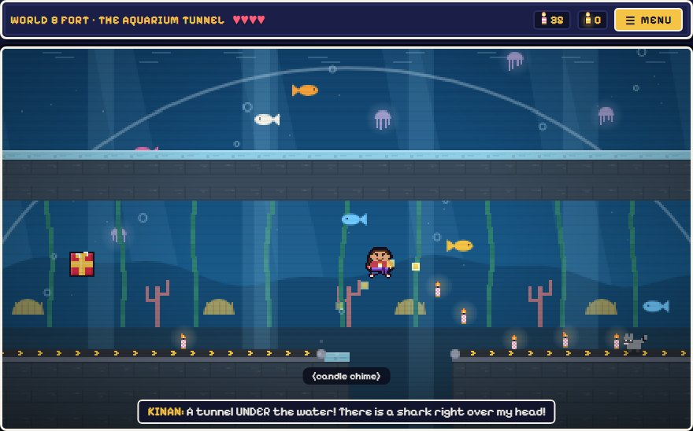 |
| **A castle level.** Lose your last heart and you're back at the checkpoint with full hearts and your candles kept. | **A fort level.** A tunnel under the water, on the way to the fort's mini-boss. |

## More to play

- **Taekwondo:** the KICK button breaks wooden boards in every world. Kinan earns belts from purple up to black from
  Sabumnim, his calm instructor, in voiced belt scenes after each world.
- **Pets to rescue:** six of them, one cat and one dog at a time. Plus candles and golden candles to find.
- **Party games** under Menu, then More games: **Family Kart**, **Family Brawl** and **Builder**.
- **An animated opening**, a cutscene after every world, and voiced story lines.

| | | |
|---|---|---|
| 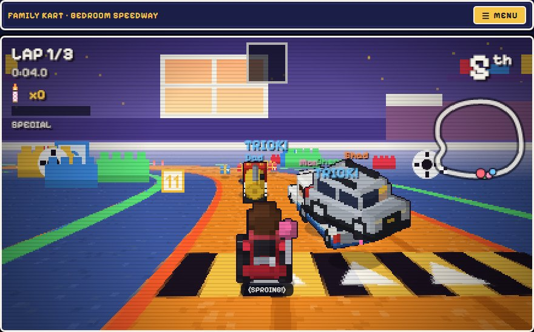 | 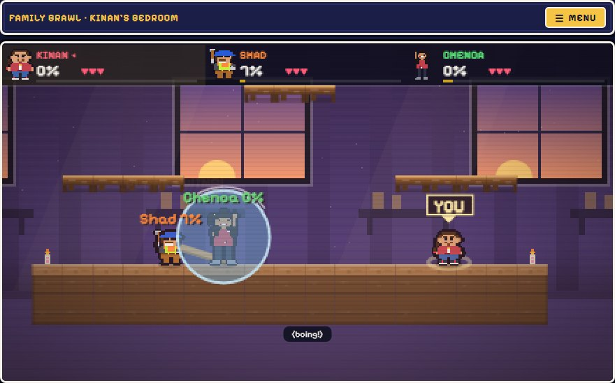 | 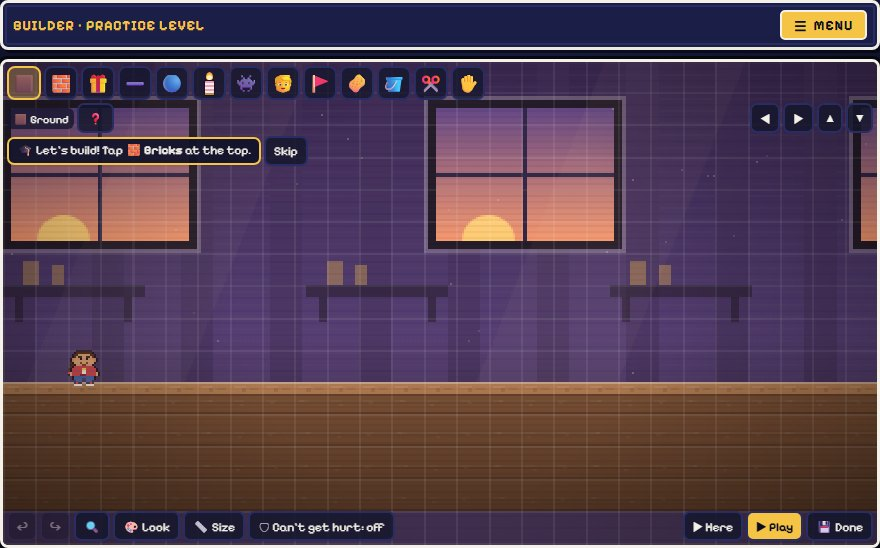 |
| **Family Kart** | **Family Brawl** | **Builder** |

## Plays everywhere

iPhone, iPad, Android, tablets and computers, with touch, keyboard or a gamepad. It installs like an app and works
offline after the first load.

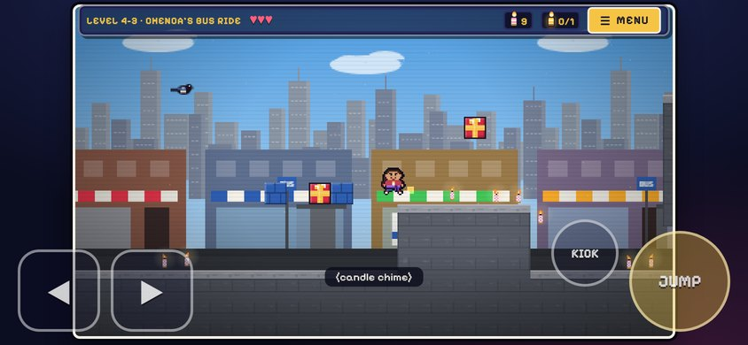

## How it was built

I designed the game: the story, the worlds, the bosses, and how every level should feel for an 11-year-old.
Claude Code (AI) wrote the code from that plan. Before a new world goes live, automated play-tests run it in seven setups
(desktop Chrome, Firefox and Safari's engine, a touch tablet, an Android phone, an iPhone and an iPad), on top of the
unit tests. It has no ads, no analytics and no network calls while you play.

**Support future worlds:** if you'd like to help, there's a Ko-fi page: https://ko-fi.com/albertancoder. The game is
free and always will be.

## Install it like an app

- **iPhone / iPad (Safari):** Share, then Add to Home Screen, then Add.
- **Android / tablet (Chrome):** Menu, then Install app.

It then opens full-screen and runs offline.

## Controls

| Action | Keyboard | Touch |
|---|---|---|
| Move | ← → / A D | ◀ ▶ |
| Jump | Space / ↑ / W (hold = higher) | JUMP |
| Kick / Pow | X / J | KICK / POW |
| Friend Assist | E | FRIEND |
| Menu / pause | P / Esc | ☰ MENU |

Phones and tablets play sideways. Held upright, a level pauses behind a rotate screen with a "Play sideways" button
(Android) and help for a locked screen; menus and the map work upright.

## Run it locally

Open `index.html` directly, or serve this folder with any static server
(the service worker and install prompt need http/https).

## Notes

- Progress is saved on the device (stars, pets, names, hats, best scores), with a verified last-known-good backup and automatic recovery from a damaged current save.
- `robots.txt` and a `noindex` meta tag keep the page out of search engines.
- No analytics, no ads, no network calls at runtime (the Ko-fi link only opens when you tap it).

More of my work: [github.com/AlbertanCoder](https://github.com/AlbertanCoder).
